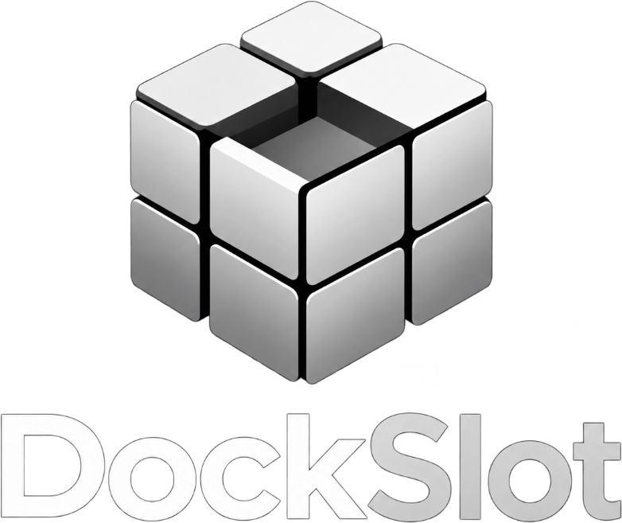
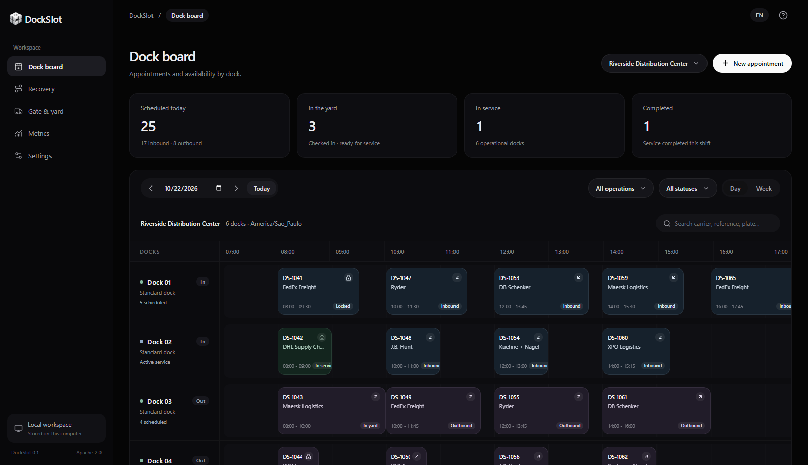

<p align="center"></p>

# DockSlot

**Open-source dock scheduling and real-time recovery engine.**

Schedule trucks, operate the gate, and review schedule changes before applying them. Run it on your own computer without creating an account or subscription. Data stays in your local PostgreSQL database.

> **0.1.0** - Read [implementation status](docs/implementation-status.md) before deploying to an operational facility.



## Quickstart

Install Node.js 24 LTS, clone this repository, and run:

```sh
npm ci
npm run local
```

Open **http://localhost:3000**. The app opens directly into the dock board. This command starts the web app, API, worker, and embedded PostgreSQL on your computer. It creates a sample facility with six docks and 25 appointments. Data and the webhook encryption key persist in the ignored `.local/` directory. Stop with Ctrl+C; run the same command to reopen your workspace.

For an empty workspace, set `DEMO_MODE=false` before the first run (`$env:DEMO_MODE='false'` in PowerShell, or `DEMO_MODE=false npm run local` on macOS/Linux). Create a facility from Settings. Demo and empty workspaces use separate organizations; switching this flag never deletes existing data.

### With Docker

If you prefer Docker Engine with Compose:

```sh
docker compose up --build -d
```

Open **http://localhost:3000**, without signing in. The initialization service migrates the database and creates sample appointments for the current date in `America/Sao_Paulo`.

- API documentation: http://localhost:4000/docs
- OpenAPI: http://localhost:4000/v1/openapi.json

The defaults use `AUTH_MODE=local` and expose ports only on loopback. Restarting does not overwrite your work. For an empty installation, set `DEMO_MODE=false` before the first start. No administrator account is created in local mode. The optional `AUTH_MODE=session` enables accounts and permissions for shared deployments; see the [deployment guide](docs/operations/deployment.md).

## Try recovery

1. Select an appointment on the **Dock board**, report a delayed ETA (for example +90 minutes), or block a dock in **Settings**.
2. Open **Recovery** (or click **Recover** inside the appointment panel). The recovery proposal loads automatically and the active schedule has not changed yet.
3. Review current/proposed allocations, explanations, projected waiting, and unallocated items.
4. Lock another appointment and click **Rerun recovery** if needed. A stale proposal cannot be approved.
5. Click **Approve & apply**. The database commits the entire replacement plan and its events atomically.
6. Open a second browser: SSE refreshes the board automatically.

The heuristic is deterministic and does not claim a global optimum. It can report infeasibility. Started services, relocation restrictions, and manual locks are preserved. Unknown ETAs are excluded from projected waiting calculations.

## Included

- Daily dock timeline, weekly view, filters, drag suggestions with explicit confirmation, keyboard-accessible slot selection.
- Booking requests/confirmation, ETA updates, priorities, capabilities, manual locks, cancellation and no-show grace periods.
- Separate booking and physical visit lifecycles; gate check-in/out and dock service actions.
- Versioned recovery snapshots, explanations, approval/rejection, PostgreSQL overlap exclusion and transactional site locks.
- Account-free local workspace by default; optional multi-user sessions, organization/site roles, and scoped API and carrier tokens.
- Public carrier request/lookup links, manual approval by default, optional automatic compatible allocation.
- CSV preview and all-or-nothing import, export, audit trail, SSE replay, HMAC webhooks, persistent retries, delivery visibility.
- Docker Compose, PostgreSQL migrations, demo seed, typed SDK source, OpenAPI, CI, property/integration/browser tests.
- English interface with a Portuguese navigation dictionary ready for further localization.

## Development

Node.js 24 LTS and PostgreSQL 16+ are required. Use `npm ci` (the lockfile is committed).

```sh
cp .env.example .env
npm ci
npm run db:migrate
DEMO_MODE=true npm run db:seed
npm run dev
```

PowerShell: set `$env:DEMO_MODE='true'` before running the seed. Use your own `DATABASE_URL` in `.env`.

`npm run local` (also available as `npm run demo:local`) starts an embedded PostgreSQL development cluster on port 55432, API on 4000 and web on 3000. Services bind to loopback. Data lives in ignored `.local/`; keep backups of it, including the encryption key. This development helper uses `initdb --no-sync` for initial cluster creation. Use managed PostgreSQL or Docker with regular backups for operational deployments. Existing system PostgreSQL installations are not modified.

```sh
npm run typecheck
npm test
npm run build
npm run benchmark
npx playwright install chromium
npm run test:e2e
```

Integration tests use a dedicated fresh `TEST_DATABASE_URL`, or start an isolated embedded PostgreSQL cluster on port 55433. Do not point tests at a database containing real data. Browser tests require the seeded demo and its services; Playwright can start API/web from the built application. See [testing](docs/operations/testing.md).

## Repository

```text
apps/web                  Next.js operator workspace and carrier portal
apps/api                  Fastify API, authorization and application services
apps/worker               PostgreSQL outbox and webhook delivery
packages/domain           Types, validation, calendar and domain invariants
packages/engine           Pure deterministic scheduling heuristic
packages/db               Versioned SQL migration, repository and demo seed
packages/sdk-typescript   Minimal typed source client
examples                  CSV and API integration examples
docs                      Architecture, operations, API and honest release scope
tests                     Property, PostgreSQL integration and Playwright tests
```

## Documentation & community

[Architecture](docs/architecture/README.md) · [API and permissions](docs/api/README.md) · [Deployment](docs/operations/deployment.md) · [Backup/restore](docs/operations/backup.md) · [Roadmap](ROADMAP.md) · [Contributing](CONTRIBUTING.md) · [Security](SECURITY.md)

DockSlot is licensed under [Apache License 2.0](LICENSE). Contributions should solve concrete warehouse workflows; operational data and personal information do not belong in public issues.
