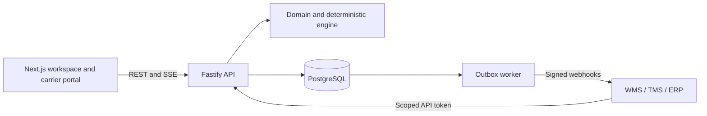

# Architecture

The browser uses Next.js and calls `/v1` through its same-origin proxy. Fastify handles commands and queries; a plain TypeScript domain/engine package handles rules. PostgreSQL is the only required infrastructure service. The worker consumes the durable outbox and creates/retries signed webhook deliveries.

## Transaction boundary

Every operational mutation is scoped by organization and site and locks the site row with `FOR UPDATE`. The service reads a consistent snapshot, checks authorization and expected versions, runs the domain action, persists entity changes, increments `current_plan_version`, records a plan revision, and writes audit/outbox events before commit. This serializes edits within a site while allowing separate sites to proceed independently.

Allocation replacement supersedes the old rows before inserting the new set in the same transaction. The PostgreSQL `btree_gist` exclusion constraint rejects active overlap even if another client bypasses the application's site lock. Composite foreign keys prevent appointments and allocations from referencing a different site. Audit events have a database trigger that prevents UPDATE/DELETE. The application never erases allocation history.

Entity payloads use typed, Zod-validated JSONB alongside relational identifiers, ownership columns and version columns. Allocation times and block intervals are native `timestamptz`; date values within payloads are canonical ISO UTC strings. This is a deliberate initial storage simplification compared to the fully column-expanded specification. Add indexed relational columns as actual query workloads demand them. RLS is not enabled; isolation is enforced in authorization and SQL scoping, with integration tests.

## Recovery

The engine receives a snapshot and explicit time horizon, never reads the database or wall clock, and does not mutate its input. It sorts by service deadline, effective priority (including age), ETA, creation time, and stable ID. It searches compatible docks and grid-aligned starts, scores valid candidates, and performs bounded reinsertion. Calendar validation handles real UTC instants in the site's IANA timezone. Costs include waiting, communicated-plan movement, soft window lateness and fragmented gaps.

The proposal persists the baseline snapshot, request, algorithm version, assignments and metrics. Applying requires the baseline version to match. The server recomputes the proposal from the locked current snapshot and compares it with the stored result, validates applicability, then replaces allocations and emits reschedule events atomically. Unscheduled confirmed bookings are never silently dropped. Infeasible proposals are visible but cannot be applied. Rejecting a proposal records an audit event.

## Events

SSE polls committed outbox events by monotonically increasing ID and supports `Last-Event-ID`. Connections close periodically to reauthenticate on reconnection. The UI also reconciles on open and every 30 seconds. Events are retained indefinitely by default, so cursor expiry is not currently configured. The worker uses `FOR UPDATE SKIP LOCKED`, deduplicates `(event_id, endpoint_id)`, and delivers at least once. A crash after the recipient accepted an event but before the transaction committed may cause a duplicate. Consumers must deduplicate event IDs.

## Boundaries

`domain` contains policy/types; `engine` contains planning; `db` contains SQL/repository/migrations; API services own authorization and transactions. The worker shares security utilities for encryption and target validation. The SDK is a source package intended for workspace use, not yet a published npm artifact. UI primitives/config are colocated in `apps/web`, not empty placeholder packages.
